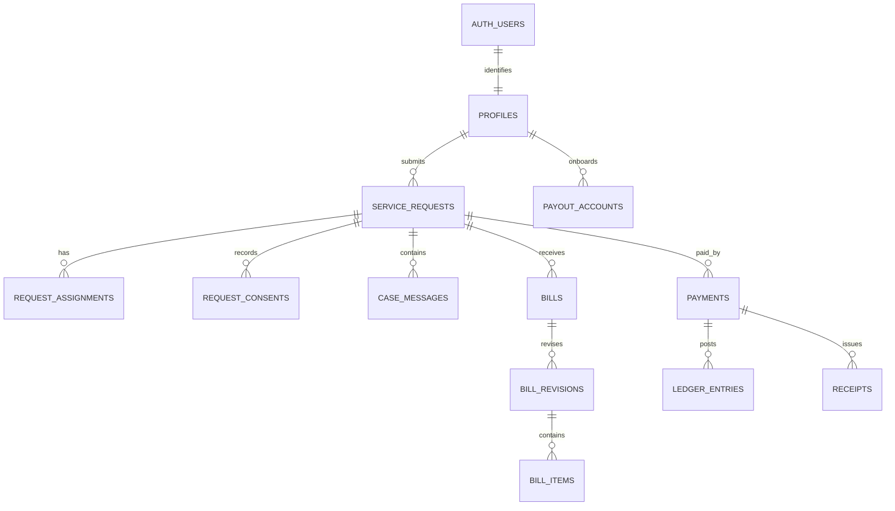

# LUCID Supabase backend implementation guide

**Audience:** backend engineer implementing the React frontend services.
**Status:** handoff specification; no production Supabase deployment or payment gateway is connected.
**Product scope checked:** 6 November 2026.

This guide defines the frontend's current role and service boundaries, the agreed case and bill lifecycle, a proposed Supabase schema, authorization rules, Edge Function responsibilities, integration order, and acceptance checks. Treat `src/services/workflow/liveWorkflowService.js` as the UI contract. Implement every unsupported method there before enabling the corresponding action in production.

## 1. Non-negotiable product rules

1. Public visitors can search and browse service categories and service details. Clients can submit requests after sign-in. Providers and Inspectors may browse but cannot request a service; route them to Client account creation.
2. Sign-in accepts email and password only. Determine role from server-owned profile/staff membership. Public registration supports Client, Provider, and Inspector only. Admin credentials and role membership are issued by IT; never expose Admin registration or role selection.
3. Provider identity and contact fields stay private from Clients. Admin can see all account details. Inspectors and Providers can edit their own private and work profiles. Exact client address/access notes are shared only with the Client, authorized LUCID staff and assigned workers as the workflow requires.
4. A Client may give an optional, non-binding expected price range as context. It is not a promise, quote, cap or accepted price. There are no payment details on the request form.
5. Admin assigns an Inspector based on category, service location, availability/capacity and proximity. Admin can extend search or choose another suitable Inspector. If none is suitable, Client consent to proceed without an Inspector is recorded once. Admin may then assign a Provider; the Provider assesses the site and starts work without another Client form. Notify the Client that no Inspector is assigned.
6. Provider can start agreed work without a quote/estimate submission. After completing the work, Provider submits the final bill (line items and optional note). Client accepts and pays through gateway checkout, or rejects with an optional note. Rejection creates a negotiation/revision loop with the Provider; Inspector approval is not a prerequisite. Keep every revision immutable and auditable.
7. Extra work and its cost must be recorded as a separate change proposal before that work starts. Client approval is explicit and timestamped; rejection leaves original agreed work unchanged. Attach approved change items to the final bill. Do not infer approval from messages.
8. Reviews are optional after completion. Provider/Inspector payout destinations are set up using payment-provider hosted onboarding. Never collect or store raw bank or mobile-money credentials in the browser or application tables. Client payment methods belong to gateway checkout and are not stored in the Client profile.
9. Cancellation policy is not finalized: current UI and old SQL may contain a GHS 75 or other example. Do not charge a cancellation fee until the board approves formula, disclosure timing, waivers, exceptions and work-already-performed treatment. Store policy versions and the Client's acknowledgement.
10. All workflow transitions, assignments, bill revisions, consents, payments, payout changes, policy actions, appeals, notification attempts and privileged message access require server-side authorization and an audit event.

## 2. Recommended implementation layout

```text
src/
  services/supabaseClient.js                 # browser Supabase client; anon key only
  services/workflow/liveWorkflowService.js   # typed/result-returning frontend boundary
  components/finance/PayoutSetupPanel.jsx    # redirects to a server-created onboarding URL
  pages/**                                   # role-aware UI; no trusted business rules
supabase/
  migrations/                                # versioned schema, RLS, triggers and RPCs
  functions/                                 # trusted role and payment operations
    create-payout-onboarding/
    create-payment-checkout/
    payment-webhook/
    send-notification/
    export-account-data/
```

The browser may use the Supabase anon key with the signed-in user's JWT. The service-role key and gateway secrets belong only in Edge Function secrets. Follow official [RLS guidance](https://supabase.com/docs/guides/database/postgres/row-level-security), [user metadata guidance](https://supabase.com/docs/guides/auth/managing-user-data), [Edge Functions](https://supabase.com/docs/guides/functions), and [Storage access control](https://supabase.com/docs/guides/storage/security/access-control).

## 3. Data model

Use UUID primary keys, `created_at`/`updated_at`, foreign keys, constrained enums or check constraints, and indexes for each listed filter. Avoid storing calculated balances without a reconciled ledger.

| Table | Core fields / purpose |
|---|---|
| `profiles` | `id = auth.users.id`, authoritative public role (`client`, `provider`, `inspector`), private name/email/phone, verification timestamps, avatar storage path, account status, profile completion. Email remains private; do not copy it to a public Provider profile. |
| `lucid_staff_memberships` | `user_id`, `role` (`admin` initially), `is_active`, grant/revoke actor and timestamps. Admin membership is created only by trusted IT/service-role procedure. |
| `client_profiles` | Client-specific preferences that are not payment preferences. No bank, MoMo, card or payment preference fields. |
| `client_service_locations` | Client-owned label, region, city, area, exact address, access notes, default flag. RLS owner-only; assignments get request-scoped access through an authorized view/RPC. |
| `provider_profiles` | Biography, years experience, skills/languages, service area/radius, categories, insurance metadata, public portfolio visibility, work availability, schedule, assignment capacity. Direct contact/email stays private. |
| `inspector_profiles` | Staff identity/work details, qualifications, service radius, categories, availability/schedule/capacity, payout readiness reference. Restrict profile details to the Inspector and authorized staff. |
| `credentials` | Owner, credential type/name/issuer/reference, expiry, private storage path, review status, reviewer and decision timestamps. Never use client filename as proof of upload or verification. |
| `portfolio_items` | Provider owner, title/caption/category, private Storage object path, consent-to-share timestamp, moderation/visibility state. Strip EXIF and enforce size/type limits. |
| `service_categories`, `services` | Public searchable catalogue, slugs, published state, images, descriptions and category relationships. |
| `service_requests` | Client, category/service, description, urgency, preferred availability, optional `suggested_range_min` and `suggested_range_max` (nullable, non-binding), current workflow status, current Inspector/Provider IDs, timestamps, cancellation state. Enforce min <= max when both supplied. |
| `request_private_details` | Request-scoped address and contact details, separate from request listing rows. Do not expose through broad joins. |
| `request_assignments` | Request, actor, role, offer/assignment state, assigned by, accepted/declined timestamps, search distance and reason; retain past rows on reassignment. |
| `inspector_reports` | Inspector, findings, safety/feasibility, checklist, private evidence paths and submitted timestamp. Preserve revisions. |
| `request_consents` | Request, Client, consent type (`proceed_without_inspector`, price change, extra work, cancellation policy), exact policy/version, decision and timestamp. Immutable. |
| `request_changes` | Admin clarification/amendment audit: old/new structured values, reason, actor and time. Client confirmation where required. |
| `bills`, `bill_revisions`, `bill_items` | Provider-submitted final bill, revision number, optional note, immutable line items, currency/totals, state (`submitted`, `rejected`, `accepted`, `paid`, `void`); one revision per submission. Use integer minor units or numeric with explicit currency precision. |
| `work_change_proposals`, `work_change_items` | Additional work description/cost, submitted by Provider, Client decision/note and timestamps; approved changes link to bill items. |
| `payments`, `payment_events` | Gateway transaction, amount/currency, idempotency key, status, provider reference, webhook event ID, verified timestamps and failure reason. Never store PAN, CVV, OTP or raw gateway secrets. |
| `ledger_accounts`, `ledger_entries` | Double-entry postings for client collection, provider payable, inspector payable, platform fee, gateway fee, refund and payout. Immutable entries; balances are derived. Fee rates are server policy versions. |
| `payout_accounts` | Internal user ID, gateway account/reference ID, onboarding/verification status, masked display only, last provider sync. Do not persist raw bank/MoMo account details. |
| `payout_transfers` | Ledger reference, provider/Inspector, amount, gateway transfer reference, idempotency key, status, webhook reconciliation and failure metadata. |
| `case_threads`, `case_messages`, `message_edits`, `message_attachments`, `message_reads` | Case-scoped participants, body/media references, edit window/history, reply-to ID, read status. Apply case participant authorization on every read/write. Voice audio and attachments use private Storage buckets and signed URLs. |
| `notifications`, `notification_preferences`, `notification_consents`, `delivery_attempts` | In-app records, category/channel, consent and provider delivery attempts. In-app event is durable even if email/SMS/push fails. |
| `reviews`, `review_flags`, `review_responses` | Optional Client review after verified completion, moderation state, Provider response; prevent duplicate review per request. |
| `receipts` | Immutable receipt number, payment and bill snapshots, role-specific disclosure snapshot, issued timestamp, PDF generation reference. |
| `policy_actions`, `account_appeals` | Admin reason/evidence, policy version, notice delivery, appeal submission, reviewer decision/reinstatement; preserve complete audit history. |
| `audit_events` | Actor, action, subject, request, before/after references, correlation ID, timestamp; append-only and inaccessible for client updates/deletes. |
| `privacy_requests` | Export/closure request, identity check state, retention/deletion completion metadata. |

### 3.1 Launch services and credential verification

The launch catalogue has exactly four categories and seven service rows. Store it in `service_categories` and `services`; do not infer new service records from free-text labels. Seed category IDs/slugs as `home-repairs`, `auto-repairs`, `cleaning`, and `construction`; seed the seven service IDs/slugs as `plumbing`, `electrical`, `carpentry`, `handyman`, `auto-mechanic`, `cleaner`, and `construction-worker`. Preserve service/category display-name snapshots on historic requests when labels change. Unknown or retired route IDs should return not found instead of silently redirecting to another service.

Use a `construction_work_types` lookup tied only to `construction-worker` for block/brick work, masonry/plastering, roofing, tiling/flooring, structural repair, and other construction work. A request must include one valid work-type ID for that service; other launch services must not accept a construction scope ID. `service_requests` stores `service_id`, category/service name snapshots, optional `construction_work_type_id`, and `prefer_verified_credential` (default false). The preference may affect ranking among otherwise suitable Provider candidates but can never filter away all candidates or prevent assignment. Provider/Inspector work profiles use a `profile_services` join table with stable service IDs; construction-capable profiles additionally use `profile_construction_work_types` restricted to the construction service. Derive category summaries from that relation for legacy UI compatibility.

Create configurable, administrator-managed `credential_types` (stable ID, display label, issuing authority family, active/effective dates, whether level is collected, display order, source/verification notes) and `credential_levels` lookup rows. Do not embed this mutable list as a Postgres enum. Seed the provisional labels from `src/data/catalog/credentialTypes.js`, but reconcile CTVET/NVTI names and grades with current authoritative sources before production. In particular, the UI collects an NVTI grade as printed rather than claiming an unconfirmed grade set. A trade-specific licence should be scoped to a service and issuer; do not require an electrical credential until Legal/Operations approves the precise work and licensing rule.

`profile_credentials` fields: `id`, `profile_id`, `credential_type_id`, `service_id`, `issuer`, `level_id` or bounded `level_text`, `certificate_number` (private), `issued_year`, `expires_at`, `document_object_key`, `verification_status` (`self_declared`, `document_uploaded`, `verified`, `rejected`, `expired`, `retired`), created/updated timestamps. Status changes are server-owned; never accept `verified` from a Provider/Inspector payload. Multiple credentials per person are allowed. `credential_reviews` is append-only: credential ID, reviewer ID, previous/new state, decision notes, check method, checked-at timestamp and evidence reference. A new submission or edited material field returns the record to `self_declared`/`document_uploaded` as appropriate and invalidates old verified-match projections until reviewed again.

Keep the `credential-evidence` Supabase Storage bucket private. The account holder may upload only to an unpredictable object key under their own folder; validate MIME type, byte size and ownership server-side. Never store base64, signed URLs, raw file bytes, or public URLs in profile rows, logs, analytics or browser persistence. A narrow Edge Function/RPC issues a short-lived signed URL to the account owner or an authorized Admin reviewer only. Storage RLS must deny Client access to all credential files, including assigned Provider files. Upload completion means `document_uploaded`, never `verified`.

The Client case view should receive a narrow server projection such as `{ credential_type_label, verification_badge: 'Verified by LUCID' }` for the assigned Provider only when the credential is active, unexpired, verified, and linked to the requested service. Do not return certificate number, issuer contact details, document key/URL, unrelated credentials, or a Provider directory. When no suitable verified credential exists, assignment must remain possible and the case projection should return no badge.

The frontend boundary is `services.credentials.listTypes`, `uploadEvidence`, and `createEvidenceLink`, plus `services.operations.reviewCredential`. These currently return `BACKEND_OPERATION_NOT_IMPLEMENTED`; wire them only after the lookup tables, private bucket, RLS and audited review function exist. Admin review requires a reason for approval or rejection. Add DB tests for owner upload/read, Client denial, Admin signed-link access, forged verified status rejection, expiry, service mismatch, and audit immutability.

### Data relationship overview



## 4. RLS and server-side transition design

Enable RLS on every user-facing table and revoke broad grants first. Add allow policies deliberately. Never trust a role sent in JSON: use `auth.uid()` and server-owned profile/staff rows. Use narrow views/RPCs for request data instead of granting direct access to private details.

- Client: read own requests, own private details, own messages, bills, payment records, receipts, notifications and profile. Insert own draft/submitted request and allowed consents. Cannot change status, assignments, price, bill, ledger or payment state.
- Provider: read only offered/assigned requests and the minimal private details required after assignment. Submit work updates, extra-work proposals and bill revisions for own assignment. Cannot choose own assignment or mark any bill paid.
- Inspector: read only assigned requests and necessary private details; submit inspection reports and communicate with assigned participants. Cannot approve bills or payments.
- Admin: only active IT-created membership may access administrative queues. Sensitive account lookup, message investigation and policy actions must emit audit events. Separate support/finance permissions if the company later adds staff roles.
- Anonymous visitor: read only published catalogue and approved public Provider profile fields/portfolio/reviews. No Provider email, phone, exact address, Client data or assignment history.
- Gateway webhook: verify the gateway signature in an Edge Function, deduplicate provider event ID, lock relevant rows, then atomically update payment and append ledger entries. Never let the browser set `paid`.

Implement state changes using SQL RPCs or Edge Functions with explicit expected-state checks, actor checks, transaction locks, idempotency keys and audit inserts. Use a single canonical transition matrix. A stale status or unauthorized actor returns a stable error code and leaves all tables unchanged. Functions that need elevated DB access use service role only inside the function runtime.

## 5. Workflow state machine

```text
submitted -> admin_review -> needs_information <-> submitted
           -> inspector_assigned -> inspection_reported
           -> client_consent_without_inspector (when no Inspector can be assigned)
inspection_reported OR client_consent_without_inspector
           -> provider_offer -> provider_assigned -> work_in_progress
work_in_progress -> extra_work_pending -> work_in_progress (approve/reject recorded)
                 -> bill_submitted -> bill_rejected -> bill_submitted (new revision)
                 -> bill_accepted -> payment_pending -> paid -> completed
```

Admin may reassign an unavailable Inspector from any pre-work inspection state; preserve the original assignment and notify Client, old Inspector and new Inspector. If the Client has already consented to proceed without an Inspector, do not create an Inspector assignment. Provider must accept before work starts. The Provider may submit the final bill after work completion; no Inspector review gate exists. A successfully paid bill completes the request and issues role-specific receipts/notifications. Client review prompt is optional and must not block completion.

The current SQL files are historic drafts and may encode an older workflow. Reconcile them against this guide and the existing deployed Supabase schema before applying. Do not assume the draft status check constraint is production-compatible.

## 6. Payment and payout integration

Gateway is not selected in this repository. Before implementation, the company must choose a licensed provider available in Ghana and approve settlement, chargeback, refund, split, payout, fee, webhook retry and reconciliation policy. Do not hardcode provider bank codes or fee percentages in frontend code.

1. Provider submits final bill. Server calculates the customer payable amount and any platform/Inspector charges from an approved versioned fee policy. Show the breakdown before checkout.
2. Client accepts; Edge Function creates gateway checkout from the accepted immutable bill revision. Return hosted checkout URL/session. The client pays through that provider UI; do not collect payment credentials in LUCID forms.
3. Gateway webhook verifies signature, idempotency and amount/currency/reference against server bill. Only then mark payment paid, append balanced ledger entries, issue receipt, and notify involved accounts.
4. Payout onboarding Edge Function creates or updates a connected payout account and returns a hosted URL. `PayoutSetupPanel.jsx` calls `finance.createPayoutOnboardingLink()` and reads `finance.getPayoutStatus()`. Provider/Inspector app displays status and masked destination only. Webhook updates readiness; browser cannot mark it active.
5. A payout request/automated payout is allowed only for a verified eligible account and sufficient ledger payable. Server initiates transfer, records idempotency, reconciles webhook and exposes failure/retry state. No frontend success toast until confirmed state is returned.
6. Refund flow is staff-authorized, linked to the original charge and produces reversing ledger entries; never delete original payment rows.

The front-end must not persist payout or client payment details to Supabase tables, local storage, analytics or logs. Supabase Edge Function secrets are configured outside the repository; see [Supabase function secrets](https://supabase.com/docs/guides/functions/secrets).

## 7. Implement UI contracts by page/service

| Frontend page or UI | Service methods / backend contract |
|---|---|
| Public Home, Services, Category, Service Details, Search | Public published catalogue queries; category facets/search pagination; support/contact form Edge Function with validation and abuse controls. |
| Sign Up / Sign In | `supabase.auth.signUp` only for public roles; email confirmation; trusted profile trigger reads signup role from validated metadata allowlist. Sign in via `signInWithPassword`, then fetch profile/staff membership. Admin invite is IT-only. Add password reset, email change and MFA flows. |
| Account setup/profile/settings | `profiles.getForRole`, `updateAccountSetup`, `updateInspectorWorkProfile`; profile image/portfolio/credential Storage upload; verification state; notification preferences; privacy request; appeals. Ensure private email and phone never enter public Provider view. |
| Client request form and case pages | `cases.create`, `listForRole`, `getById`, `apply` for valid Client actions; save private details separately; optional non-binding price range; admin amendments; case consent. |
| Admin workflow hub and case detail | Admin queue, case/private detail RPC, inspector/provider candidate search, assignment/reassignment mutation, account directory, policy/appeal/review workflows, transaction/receipt search, audit trail. |
| Inspector dashboard/profile/finance | Assigned case list/detail, inspection report submit, message links, assigned case history, earnings/ledger, secure payout setup/status; no invoice approval action. |
| Provider work/dashboard/profile/finance | Offers/assignment, accept/decline, start/complete, extra-work proposal, final bill and revision, optional Client review response, earnings/ledger and payout setup/status. |
| Client dashboard/case/bill/payment/receipt | Case list/status, clarification, assigned participant info, bill accept/reject with optional note, checkout redirect, payment confirmation, downloadable receipt, optional review, cancellation rules/fee only after approved policy. |
| Messages | `messages.listConversations`, `listMessages`, `sendMessage`, `editMessage`, reply threading, attachment upload, participant list, read/update. Store edit history and enforce two-minute edit cutoff server-side. |
| Notifications | `notifications.listForRole`, `markRead`, `markAllRead`, `getPreferences`, `savePreferences`, `listConsentHistory`; durable in-app queue and separate delivery workers. |
| Receipts, transactions, account history | Role-filtered paginated queries, date/status/category filters, receipt snapshots/PDF, CSV export. Admin sees all with audited access; each role sees only their legal disclosure. |

Each method must return `{data, error}` consistently. Replace `unsupported()` stubs in `src/services/workflow/liveWorkflowService.js` as backend components become available. Keep query names/types aligned with callers; include stable business error codes. Do not silently return empty successful arrays when backend is not implemented.

## 8. Storage buckets and files

Use private buckets for `profile-avatars`, `provider-portfolio`, `credentials`, `case-evidence`, and `message-attachments`. Store only object paths in relational rows. Restrict upload/read/delete policies by `auth.uid()` and case assignment; use short-lived signed URLs. Validate MIME and file signatures server-side, enforce size/count limits, malware scan where available, strip image EXIF/location data, and record consent for portfolio photos. Public Provider portfolio access should use a restricted transformation/view that excludes metadata and is enabled only after explicit owner consent and moderation.

## 9. Notifications, privacy and appeals

Create notification rows transactionally with case state changes, then deliver through queued workers. Support email/SMS/push preferences separately by transactional, security, request, payment and marketing categories. Record channel consent and revocation. A failed delivery should be retried and visible to Admin; it must not roll back the case transition.

Appeal submission is available to suspended/closed holders from Account Settings. Admin queue supports evidence review and approve/reject with reason; reinstatement is an audited state transition, not a local UI toggle. Policy form records decision, policy basis, effective date and notice attempt. Account deletion/export must follow legal retention and dispute obligations; do not promise immediate deletion of financial/audit records.

## 10. Build and verification sequence

1. Inventory the target Supabase schema, Auth settings, existing RLS and current data. Confirm backups and migration environment. Never apply these drafts blindly to a live project.
2. Select gateway and settle commercial rules: fee rates, Inspector compensation, charge timing, extra work, refunds, cancellation policy and payout eligibility.
3. Create schema migrations and RLS first. Seed only catalogue data. Create test users for each role through Supabase Auth, including Admin via trusted provisioning.
4. Implement RPC/Edge Function transition contracts and audit/notification transactions. Add idempotency, concurrency and error response coverage.
5. Implement Storage policies and private/media handling.
6. Connect each service method in `liveWorkflowService.js`; update page-level loading, empty, error, retry and success states. Never report success if the mutation returns an error or merely returns a gateway redirect.
7. Build payment checkout, signed webhooks, ledger, receipts, payout onboarding and payout reconciliation in sandbox. Keep secrets out of Vite environment variables.
8. Write automated DB authorization tests for allowed and denied cases. Supabase recommends local policy tests with `supabase test db`; see [database testing](https://supabase.com/docs/guides/local-development/testing/overview). Add browser tests for all roles, state transitions and responsive states.
9. Run migration lint/review, RLS negative tests, webhook replay tests, payment reconciliation tests, accessibility review, `npm run lint`, `npm run build`, and staging walkthrough. Confirm production environment variables and CSP before deploy.

### Required acceptance test matrix

- Client cannot see another Client request, exact address, private messages, Provider contact, payout data, or Admin route.
- Provider/Inspector cannot enumerate cases not offered/assigned; Client cannot assign workers or write a payment status.
- Admin membership cannot be self-created through signup/profile metadata.
- Out-of-order and duplicate workflow actions fail safely and create no partial ledger or status updates.
- Inspector reassignment retains old assignment, notifies affected users and changes access only as designed.
- No-Inspector path captures Client consent exactly once and allows Provider assignment/work without a second consent form.
- Final bill rejection retains the original submission; each resubmission is versioned. Extra work cannot begin without recorded Client approval.
- Gateway fake/duplicate/invalid-signature/amount-mismatch webhooks do not mark a bill paid. A valid webhook is idempotent and creates balanced ledger postings and one receipt.
- Payout status is provider-webhook owned; raw account credentials do not appear in browser storage, database, logs, analytics or network payloads to LUCID APIs.
- Optional review can be skipped and does not keep a paid case open.
- Every profile/private contact, notification preference, appeal, policy action, media file and receipt respects role-specific visibility and retention.

## 11. Current implementation limitations

The workspace UI and Supabase Auth boundary are prepared, but most workflow service methods remain explicitly unsupported, and the migration drafts predate current product decisions. No real user authentication or request persistence can be verified without project credentials/schema. No payment provider is selected or connected. This handoff is not production-ready; it is a backend implementation contract. Production use is blocked until Sections 4–10 are implemented, tested against a staging Supabase project and reviewed for applicable Ghanaian data-protection, consumer, payment and tax obligations by qualified counsel.
